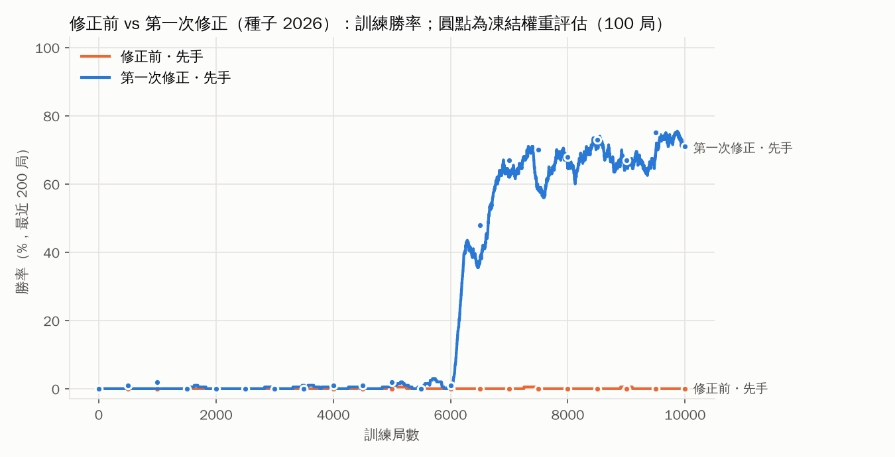
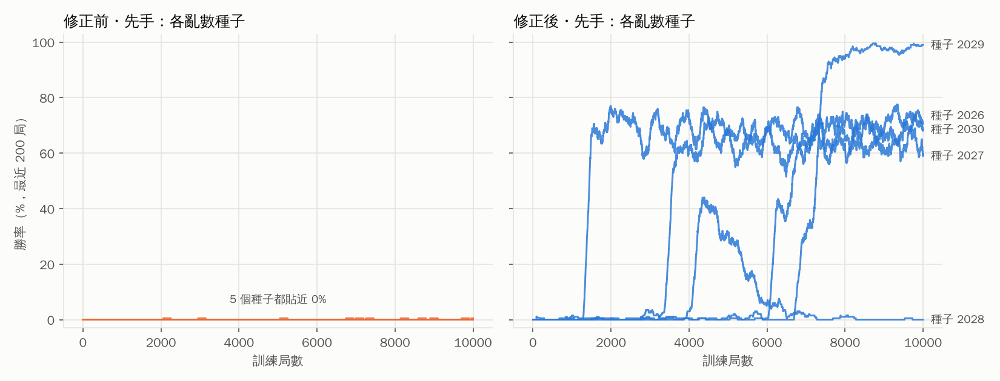
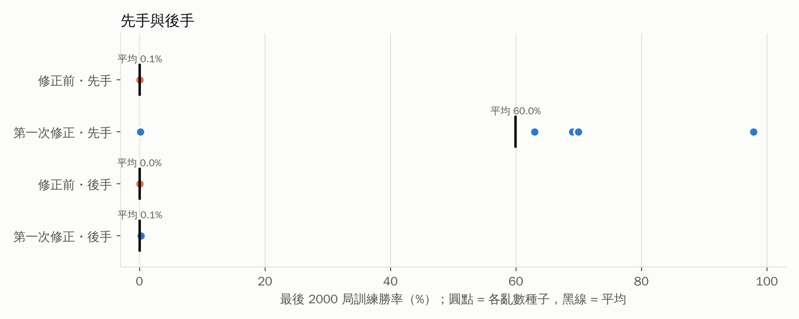
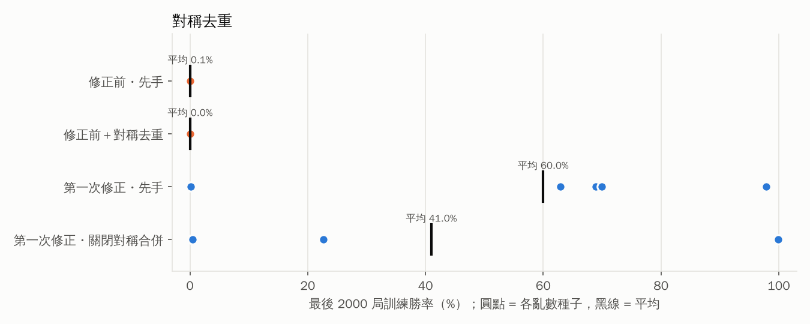
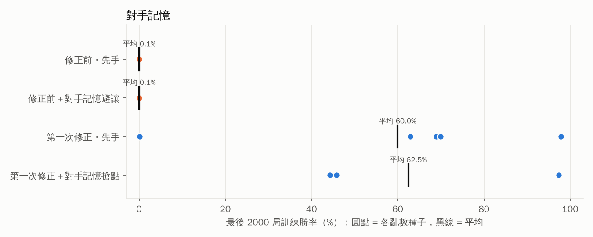
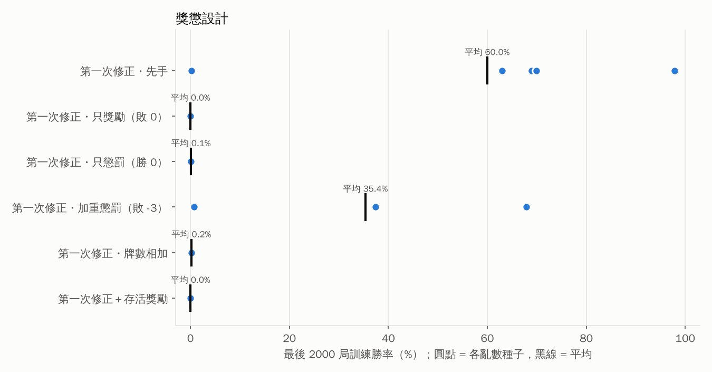
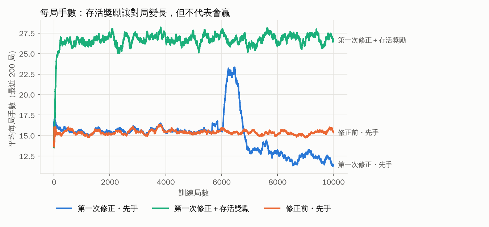
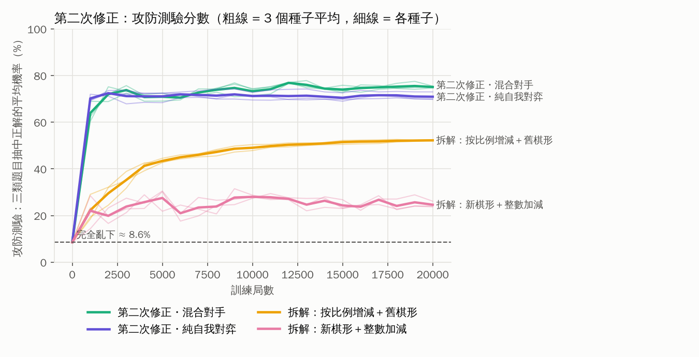
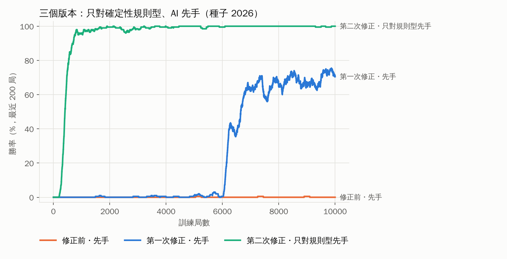
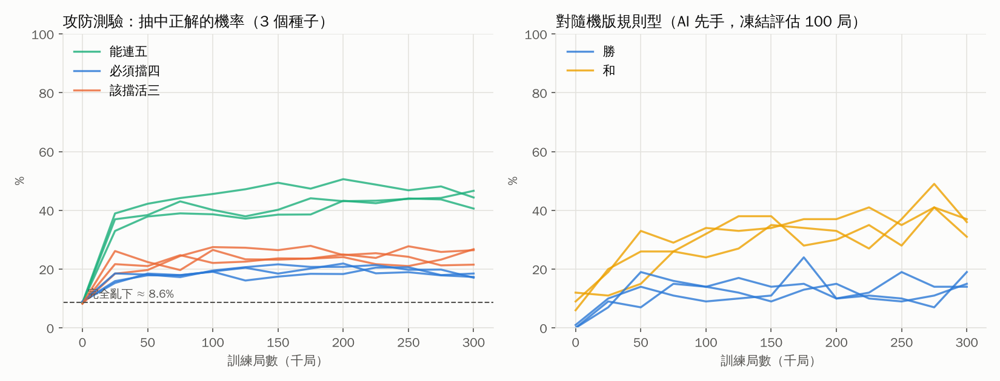

# 7×7 五子棋位子牌學習 AI：實驗結果（自動產生）

本檔由 `python main.py report` 依 `data/experiments/` 的實驗輸出自動產生，所有數字皆來自實際執行。

## 定義

- **首次勝利**：訓練過程中 AI 第一次獲勝的局號；「首次勝利前的敗局數」= 首次勝利局號 − 1（期間的和局也計入）。
- **穩定勝利**：最近 50 局訓練勝率第一次達到 50% 以上的局號。
- **評估**：複製一份權重、關閉學習後對弈，不會改動受測的學習資料。
- 訓練對手：確定性規則型對手（能連五就連、對手要連五就擋，否則下最靠近中央的空位）。

## 1. 修正前 vs 第一次修正（主要實驗，種子 2026，AI 先手）



|  | 修正前（整盤局面位子牌） | 第一次修正（棋形位子牌） |
|---|---|---|
| 訓練局數 | 10000 | 10000 |
| 訓練勝 / 敗 / 和 | 3 / 9992 / 5 | 2526 / 7438 / 36 |
| 首次勝利（第幾局） | 5048 | 1491 |
| 首次勝利前的敗局數 | 5047 | 1490 |
| 穩定勝利（第幾局） | 未出現 | 6201 |
| 學習資料筆數 | 45611 | 744 |

每 500 局一段的訓練勝率：

| 局數 | 1-500 | 501-1000 | 1001-1500 | 1501-2000 | 2001-2500 | 2501-3000 | 3001-3500 | 3501-4000 | 4001-4500 | 4501-5000 | 5001-5500 | 5501-6000 | 6001-6500 | 6501-7000 | 7001-7500 | 7501-8000 | 8001-8500 | 8501-9000 | 9001-9500 | 9501-10000 |
|---|---|---|---|---|---|---|---|---|---|---|---|---|---|---|---|---|---|---|---|---|
| 修正前 | 0.0% | 0.0% | 0.0% | 0.0% | 0.0% | 0.0% | 0.0% | 0.0% | 0.0% | 0.0% | 0.2% | 0.0% | 0.0% | 0.0% | 0.2% | 0.0% | 0.0% | 0.2% | 0.0% | 0.0% |
| 第一次修正 | 0.0% | 0.0% | 0.2% | 0.2% | 0.0% | 0.2% | 0.4% | 0.4% | 0.2% | 0.4% | 0.8% | 1.4% | 36.2% | 59.2% | 64.6% | 65.2% | 69.0% | 67.0% | 67.6% | 72.2% |

### 訓練後評估（凍結權重）

修正前：

| 評估對手 | 局數 | 勝 | 敗 | 和 | 勝率 |
|---|---|---|---|---|---|
| 規則型（確定性，訓練對手） | 200 | 0 | 200 | 0 | 0.0% |
| 規則型（隨機版） | 200 | 0 | 173 | 27 | 0.0% |
| 棋形計分規則型 | 200 | 0 | 200 | 0 | 0.0% |
| 隨機 | 200 | 91 | 88 | 21 | 45.5% |
| Minimax 深度 2 | 200 | 0 | 200 | 0 | 0.0% |
| Rapfi（外部引擎） | 100 | 0 | 100 | 0 | 0.0% |

第一次修正：

| 評估對手 | 局數 | 勝 | 敗 | 和 | 勝率 |
|---|---|---|---|---|---|
| 規則型（確定性，訓練對手） | 200 | 142 | 58 | 0 | 71.0% |
| 規則型（隨機版） | 200 | 62 | 125 | 13 | 31.0% |
| 棋形計分規則型 | 200 | 0 | 200 | 0 | 0.0% |
| 隨機 | 200 | 172 | 21 | 7 | 86.0% |
| Minimax 深度 2 | 200 | 0 | 200 | 0 | 0.0% |
| Rapfi（外部引擎） | 100 | 0 | 100 | 0 | 0.0% |

## 2. 多個亂數種子



| 設定 | 種子 | 訓練勝場 | 首次勝利（第幾局） | 穩定勝利（第幾局） | 前 500 局勝率 | 最後 2000 局勝率 | 訓練後評估勝率（200 局） |
|---|---|---|---|---|---|---|---|
| 修正前・先手 | 2026 | 3 | 5048 | 未出現 | 0.0% | 0.1% | 0.0% |
| 修正前・先手 | 2027 | 4 | 2055 | 未出現 | 0.0% | 0.1% | 0.0% |
| 修正前・先手 | 2028 | 2 | 2949 | 未出現 | 0.0% | 0.1% | 0.0% |
| 修正前・先手 | 2029 | 1 | 8595 | 未出現 | 0.0% | 0.1% | 0.0% |
| 修正前・先手 | 2030 | 1 | 9957 | 未出現 | 0.0% | 0.1% | 0.0% |
| 第一次修正・先手 | 2026 | 2526 | 1491 | 6201 | 0.0% | 69.0% | 71.0% |
| 第一次修正・先手 | 2027 | 4153 | 1570 | 3486 | 0.0% | 62.9% | 63.0% |
| 第一次修正・先手 | 2028 | 554 | 861 | 4360 | 0.0% | 0.1% | 0.0% |
| 第一次修正・先手 | 2029 | 2856 | 1998 | 7201 | 0.0% | 97.9% | 98.0% |
| 第一次修正・先手 | 2030 | 6040 | 88 | 1336 | 0.2% | 70.0% | 72.5% |

## 3. 先後手



| 設定 | 種子數 | 最後 2000 局平均勝率 | 範圍 | 達到穩定勝利的種子 | 各種子首次勝利局號 |
|---|---|---|---|---|---|
| 修正前・先手 | 5 | 0.1% | 0.1% ~ 0.1% | 0/5 | 5048, 2055, 2949, 8595, 9957 |
| 修正前・後手 | 3 | 0.0% | 0.0% ~ 0.0% | 0/3 | 未出現, 未出現, 未出現 |
| 第一次修正・先手 | 5 | 60.0% | 0.1% ~ 97.9% | 5/5 | 1491, 1570, 861, 1998, 88 |
| 第一次修正・後手 | 3 | 0.1% | 0.0% ~ 0.2% | 0/3 | 1703, 未出現, 108 |

| 設定 | 種子 | 訓練勝場 | 首次勝利（第幾局） | 穩定勝利（第幾局） | 前 500 局勝率 | 最後 2000 局勝率 | 訓練後評估勝率（200 局） |
|---|---|---|---|---|---|---|---|
| 修正前・後手 | 2026 | 0 | 未出現 | 未出現 | 0.0% | 0.0% | 0.0% |
| 修正前・後手 | 2027 | 0 | 未出現 | 未出現 | 0.0% | 0.0% | 0.0% |
| 修正前・後手 | 2028 | 0 | 未出現 | 未出現 | 0.0% | 0.0% | 0.0% |
| 第一次修正・後手 | 2026 | 3 | 1703 | 未出現 | 0.0% | 0.1% | 0.0% |
| 第一次修正・後手 | 2027 | 0 | 未出現 | 未出現 | 0.0% | 0.0% | 0.0% |
| 第一次修正・後手 | 2028 | 9 | 108 | 未出現 | 0.2% | 0.2% | 0.0% |

## 4. 對稱去重



| 設定 | 種子數 | 最後 2000 局平均勝率 | 範圍 | 達到穩定勝利的種子 | 各種子首次勝利局號 |
|---|---|---|---|---|---|
| 修正前・先手 | 5 | 0.1% | 0.1% ~ 0.1% | 0/5 | 5048, 2055, 2949, 8595, 9957 |
| 修正前＋對稱去重 | 3 | 0.0% | 0.0% ~ 0.1% | 0/3 | 5048, 2055, 2949 |
| 第一次修正・先手 | 5 | 60.0% | 0.1% ~ 97.9% | 5/5 | 1491, 1570, 861, 1998, 88 |
| 第一次修正・關閉對稱合併 | 3 | 41.0% | 0.5% ~ 99.9% | 2/3 | 190, 889, 778 |

修正前（整盤局面）的局面數量：

| 設定 | 種子 | 記錄的局面數 | 若做對稱去重剩下 | 只遇過 1 次 | 遇過 2 次以上 | 遇過 10 次以上 |
|---|---|---|---|---|---|---|
| 修正前・先手 | 2026 | 45611 | 42336 | 42196 | 3415 | 447 |
| 修正前・先手 | 2027 | 45641 | 42409 | 42206 | 3435 | 452 |
| 修正前・先手 | 2028 | 45707 | 42538 | 42332 | 3375 | 441 |
| 修正前・先手 | 2029 | 45153 | 42058 | 41714 | 3439 | 443 |
| 修正前・先手 | 2030 | 45139 | 42010 | 41697 | 3442 | 465 |
| 修正前＋對稱去重 | 2026 | 42440 | （已去重） | 38142 | 4298 | 548 |
| 修正前＋對稱去重 | 2027 | 42333 | （已去重） | 38096 | 4237 | 550 |
| 修正前＋對稱去重 | 2028 | 42554 | （已去重） | 38347 | 4207 | 547 |

第一次修正（棋形）的棋形牌數量：

| 設定 | 種子 | 棋形牌數 | 高於初始值 | 低於初始值 |
|---|---|---|---|---|
| 第一次修正・先手 | 2026 | 744 | 77 | 646 |
| 第一次修正・先手 | 2027 | 683 | 36 | 630 |
| 第一次修正・先手 | 2028 | 664 | 108 | 543 |
| 第一次修正・先手 | 2029 | 676 | 55 | 612 |
| 第一次修正・先手 | 2030 | 718 | 26 | 689 |
| 第一次修正・關閉對稱合併 | 2026 | 2955 | 31 | 2905 |
| 第一次修正・關閉對稱合併 | 2027 | 2984 | 69 | 2885 |
| 第一次修正・關閉對稱合併 | 2028 | 2114 | 47 | 2061 |

## 5. 對手記憶



| 設定 | 種子數 | 最後 2000 局平均勝率 | 範圍 | 達到穩定勝利的種子 | 各種子首次勝利局號 |
|---|---|---|---|---|---|
| 修正前・先手 | 5 | 0.1% | 0.1% ~ 0.1% | 0/5 | 5048, 2055, 2949, 8595, 9957 |
| 修正前＋對手記憶避讓 | 3 | 0.1% | 0.1% ~ 0.1% | 0/3 | 5048, 2055, 2949 |
| 第一次修正・先手 | 5 | 60.0% | 0.1% ~ 97.9% | 5/5 | 1491, 1570, 861, 1998, 88 |
| 第一次修正＋對手記憶搶點 | 3 | 62.5% | 44.2% ~ 97.3% | 3/3 | 384, 59, 478 |

修正前的對手記憶（以整盤局面記錄）：

| 設定 | 種子 | 記錄的對手局面 | 觀察手數 | 重複遇到的局面 | 其中對手每次下同一點 | 對手曾直接五連的局面 |
|---|---|---|---|---|---|---|
| 修正前・先手 | 2026 | 55602 | 76905 | 3414 | 100.0% | 9991 |
| 修正前・先手 | 2027 | 55632 | 76975 | 3435 | 100.0% | 9992 |
| 修正前・先手 | 2028 | 55700 | 77003 | 3374 | 100.0% | 9994 |
| 修正前・先手 | 2029 | 55148 | 76522 | 3439 | 100.0% | 9996 |
| 修正前・先手 | 2030 | 55134 | 76493 | 3442 | 100.0% | 9995 |
| 修正前＋對手記憶避讓 | 2026 | 55595 | 76897 | 3413 | 100.0% | 9992 |
| 修正前＋對手記憶避讓 | 2027 | 55633 | 76975 | 3434 | 100.0% | 9993 |
| 修正前＋對手記憶避讓 | 2028 | 55700 | 77003 | 3374 | 100.0% | 9994 |

「避讓」實際觸發次數（以種子 2026 重新模擬 3000 局）：AI 共落子 23059 次，其中 5 次有候選位置因對手記憶被降低機率（5 局）。同期對手記憶記錄了 17936 個局面，其中 2998 個是對手曾直接五連的局面；重複遇到的 1158 個局面中，對手每次都下同一點的比例為 100.0%。

## 6. 獎懲設計



| 設定 | 種子數 | 最後 2000 局平均勝率 | 範圍 | 達到穩定勝利的種子 | 各種子首次勝利局號 |
|---|---|---|---|---|---|
| 第一次修正・先手 | 5 | 60.0% | 0.1% ~ 97.9% | 5/5 | 1491, 1570, 861, 1998, 88 |
| 第一次修正・只獎勵（敗 0） | 3 | 0.0% | 0.0% ~ 0.0% | 0/3 | 5146, 2055, 3289 |
| 第一次修正・只懲罰（勝 0） | 3 | 0.1% | 0.1% ~ 0.1% | 0/3 | 1491, 1570, 861 |
| 第一次修正・加重懲罰（敗 -3） | 3 | 35.4% | 0.8% ~ 67.9% | 2/3 | 629, 277, 72 |
| 第一次修正・牌數相加 | 3 | 0.2% | 0.1% ~ 0.2% | 0/3 | 1443, 2497, 55 |
| 第一次修正＋存活獎勵 | 3 | 0.0% | 0.0% ~ 0.0% | 0/3 | 未出現, 未出現, 未出現 |



## 6.1 各設定訓練後對不同對手的評估（凍結權重）

評估對手中只有第一個是訓練時用的對手；其他對手用來檢查學到的東西能否推廣。

| 設定（種子 2026） | 規則型（確定性，訓練對手） | 規則型（隨機版） | 棋形計分規則型 | 隨機 | Minimax 深度 2 | Rapfi（外部引擎） |
|---|---|---|---|---|---|---|
| 修正前・先手 | 0.0% | 0.0% | 0.0% | 45.5% | 0.0% | 0.0% |
| 第一次修正・先手 | 71.0% | 31.0% | 0.0% | 86.0% | 0.0% | 0.0% |
| 第一次修正＋對手記憶搶點 | 48.5% | 5.0% | 0.0% | 64.5% | 0.0% | 0.0% |
| 第一次修正・關閉對稱合併 | 0.0% | 13.0% | 0.0% | 87.5% | 0.0% | 0.0% |
| 第一次修正・加重懲罰（敗 -3） | 77.5% | 7.0% | 0.0% | 73.5% | 0.0% | 0.0% |
| 第一次修正＋存活獎勵 | 0.0% | 0.0% | 0.0% | 43.5% | 0.0% | 0.0% |
| 修正前・後手 | 0.0% | 1.5% | 0.0% | 39.5% | 0.0% | 0.0% |
| 第一次修正・後手 | 0.0% | 11.5% | 0.0% | 87.0% | 0.0% | 0.0% |
| 修正前・對隨機 | 0.0% | 0.5% | 0.0% | 45.5% | 0.0% | 0.0% |
| 第一次修正・對隨機 | 0.0% | 0.0% | 0.0% | 81.0% | 0.0% | 0.0% |

## 7. 對隨機對手

| 設定 | 種子數 | 最後 2000 局平均勝率 | 範圍 | 達到穩定勝利的種子 | 各種子首次勝利局號 |
|---|---|---|---|---|---|
| 修正前・對隨機 | 1 | 49.9% | 49.9% ~ 49.9% | 1/1 | 1 |
| 第一次修正・對隨機 | 1 | 75.9% | 75.9% ~ 75.9% | 1/1 | 1 |

修正前・對隨機，每 500 局一段的訓練勝率：
53.6%, 51.4%, 46.4%, 48.6%, 51.8%, 49.4%, 50.6%, 48.0%, 50.8%, 48.8%, 53.2%, 50.2%, 49.8%, 51.2%, 47.2%, 50.6%, 49.6%, 50.2%, 47.8%, 52.0%

第一次修正・對隨機，每 500 局一段的訓練勝率：
63.4%, 74.6%, 72.0%, 73.8%, 78.0%, 75.8%, 75.2%, 77.8%, 75.6%, 77.4%, 79.4%, 78.2%, 76.4%, 75.2%, 79.0%, 72.4%, 74.6%, 74.0%, 75.8%, 79.2%

## 8. 權重變化實例

### 修正前：第 1 局（每個局面的牌組都是新的）

棋局 `baseline_first-train-000001`，結果 `ai_loss`，共 16 手。

| 第幾手 | AI 選擇 | 可選位置數 | 牌組總數 | 選中位置牌數（前） | 抽中機率 | 增減 | 牌數（後） |
|---|---|---|---|---|---|---|---|
| 1 | (5,1) | 49 | 490 | 10 | 2.04% | -1 | 9 |
| 3 | (6,6) | 47 | 470 | 10 | 2.13% | -1 | 9 |
| 5 | (2,4) | 45 | 450 | 10 | 2.22% | -1 | 9 |
| 7 | (4,3) | 43 | 430 | 10 | 2.33% | -1 | 9 |
| 9 | (5,4) | 41 | 410 | 10 | 2.44% | -1 | 9 |
| 11 | (6,5) | 39 | 390 | 10 | 2.56% | -1 | 9 |
| 13 | (0,0) | 37 | 370 | 10 | 2.70% | -1 | 9 |
| 15 | (4,1) | 35 | 350 | 10 | 2.86% | -1 | 9 |

### 第一次修正：第一場勝局的棋形牌變化

第一場勝局 `improved_first-train-001491`（共 33 手）。棋形字串為該位置某方向左右各 4 格，0 空、1 自己、2 對手、3 棋盤外。

| 第幾手 | AI 選擇 | 四個方向的棋形 | 棋形牌數（前） | 棋形牌數（後） | 抽中機率 |
|---|---|---|---|---|---|
| 1 | (3,3) | 30000003 / 30000003 / 30000003 / 30000003 | 1 / 1 / 1 / 1 | 22 / 22 / 22 / 22 | 2.04% |
| 3 | (6,3) | 30000003 / 21003333 / 30003333 / 30003333 | 1 / 1 / 1 / 1 | 22 / 4 / 7 / 7 | 2.13% |
| 5 | (1,2) | 00000033 / 00200333 / 00020333 / 33000333 | 1 / 1 / 1 / 1 | 10 / 7 / 7 / 7 | 1.82% |
| 7 | (2,5) | 00200333 / 00000033 / 33000333 / 00020333 | 1 / 1 / 1 / 1 | 7 / 10 / 7 / 7 | 1.89% |
| 9 | (3,6) | 21203333 / 30000003 / 30013333 / 31003333 | 1 / 1 / 1 / 1 | 4 / 22 / 7 / 4 | 2.44% |
| 11 | (5,2) | 00000033 / 10200333 / 33001333 / 01220333 | 1 / 1 / 1 / 1 | 10 / 4 / 4 / 7 | 2.27% |
| 13 | (2,4) | 00221033 / 00020033 / 33002033 / 00010033 | 1 / 1 / 1 / 1 | 4 / 7 / 7 / 4 | 2.33% |
| 15 | (5,0) | 00103333 / 00000333 / 33303333 / 02203333 | 1 / 1 / 1 / 1 | 4 / 4 / 7 / 4 | 2.17% |
| 17 | (4,4) | 00020033 / 00120033 / 00210033 / 33002033 | 1 / 1 / 1 / 1 | 7 / 4 / 4 / 7 | 2.56% |
| 19 | (0,3) | 30000003 / 21223333 / 31103333 / 30013333 | 1 / 1 / 1 / 1 | 22 / 4 / 4 / 7 | 2.78% |
| 21 | (5,6) | 12003333 / 00100333 / 12203333 / 33303333 | 1 / 1 / 1 / 1 | 4 / 4 / 4 / 7 | 3.12% |
| 23 | (2,6) | 22113333 / 01010033 / 33003333 / 02123333 | 1 / 1 / 1 / 1 | 4 / 4 / 4 / 4 | 1.85% |
| 25 | (5,5) | 01201333 / 01200333 / 02110333 / 33300333 | 1 / 1 / 1 / 1 | 4 / 4 / 4 / 4 | 1.72% |
| 27 | (4,1) | 01220333 / 00220033 / 33112333 / 02221333 | 1 / 1 / 6 / 1 | 7 / 4 / 9 / 4 | 6.06% |
| 29 | (5,4) | 10121133 / 21210333 / 02220333 / 33121333 | 10 / 7 / 1 / 6 | 13 / 10 / 4 / 9 | 95.02% |
| 31 | (4,6) | 22123333 / 00111033 / 22123333 / 33013333 | 1 / 2 / 1 / 1 | 7 / 5 / 7 / 4 | 6.45% |
| 33 | (6,6) | 01003333 / 11113333 / 21113333 / 33333333 | 1 / 10 / 2 / 1 | 4 / 13 / 5 / 4 | 33.33% |

第一場勝局的終局盤面（X = 黑/AI 先手，O = 白/對手）：

```
   0 1 2 3 4 5 6
0  . . O X . . .
1  . . X O O . O
2  . O O O X X X
3  O O O X O O X
4  . X O O X O X
5  X . X O X X X
6  . . . X . . X
```

## 9. 由敗至贏的對弈紀錄索引

- **修正前・先手**：棋譜 `data/matches/baseline_first_train.jsonl`；勝局共 3 局；前 10 場勝局局號：5048, 7252, 8900
- **第一次修正・先手**：棋譜 `data/matches/improved_first_train.jsonl`；勝局共 2526 局；前 10 場勝局局號：1491, 1628, 2828, 3310, 3468, 3568, 3798, 4258, 4834, 4983
- **修正前・後手**：棋譜 `data/matches/baseline_second_train.jsonl`；勝局共 0 局；前 10 場勝局局號：無
- **第一次修正・後手**：棋譜 `data/matches/improved_second_train.jsonl`；勝局共 3 局；前 10 場勝局局號：1703, 5048, 8900

重播任一局：`python main.py replay data/matches/improved_first_train.jsonl improved_first-train-000123 --step`

## 10. 第二次修正：棋形計數牌＋按比例增減牌數

第一次修正後的 AI 對訓練對手有勝率，但只是背下了打敗那個固定對手的路線。下面的「攻防測驗」從實際對局取出「能連五」「必須擋四」「該擋活三」三類題目各 200 題，計算 AI 依位子牌抽中正確位置的機率（規則只用來出題評分，不參與學習）。

### 10.1 攻防測驗

| 設定 | 種子數 | 能連五：抽中正解的機率 | 必須擋四：抽中正解的機率 | 該擋活三：抽中正解的機率 |
|---|---|---|---|---|
| 完全亂下（對照） | — | 8.5% | 8.9% | 8.3% |
| 修正前・先手 | 1 | 8.5% | 8.9% | 8.3% |
| 第一次修正・先手 | 5 | 16.8%（5.9%～20.4%） | 6.9%（3.7%～8.0%） | 5.6%（2.6%～10.4%） |
| 只靠規則・自我對弈 | 3 | 43.9%（40.6%～46.6%） | 17.6%（17.1%～18.5%） | 24.9%（21.5%～26.8%） |
| 第二次修正・只對規則型先手 | 3 | 70.8%（52.4%～86.6%） | 17.9%（4.3%～27.7%） | 12.5%（6.0%～18.8%） |
| 第二次修正・混合對手 | 3 | 65.5%（63.5%～66.7%） | 75.3%（72.6%～77.0%） | 84.4%（83.2%～85.3%） |
| 第二次修正・純自我對弈 | 3 | 56.8%（51.9%～60.3%） | 71.2%（68.2%～72.8%） | 84.8%（83.1%～86.0%） |
| 拆解：按比例增減＋舊棋形 | 3 | 39.6%（38.2%～40.6%） | 39.8%（39.3%～40.7%） | 77.3%（75.1%～79.9%） |
| 拆解：新棋形＋整數加減 | 3 | 48.6%（42.3%～52.5%） | 8.5%（3.8%～13.0%） | 16.7%（14.4%～20.1%） |



### 10.2 與前兩版相同條件：只對確定性規則型對手



| 設定 | 種子數 | 最後 2000 局平均勝率 | 範圍 | 達到穩定勝利的種子 | 各種子首次勝利局號 |
|---|---|---|---|---|---|
| 修正前・先手 | 5 | 0.1% | 0.1% ~ 0.1% | 0/5 | 5048, 2055, 2949, 8595, 9957 |
| 第一次修正・先手 | 5 | 60.0% | 0.1% ~ 97.9% | 5/5 | 1491, 1570, 861, 1998, 88 |
| 第二次修正・只對規則型先手 | 3 | 99.7% | 99.4% ~ 99.9% | 3/3 | 200, 2730, 1600 |
| 修正前・後手 | 3 | 0.0% | 0.0% ~ 0.0% | 0/3 | 未出現, 未出現, 未出現 |
| 第一次修正・後手 | 3 | 0.1% | 0.0% ~ 0.2% | 0/3 | 1703, 未出現, 108 |
| 第二次修正・只對規則型後手 | 3 | 78.0% | 34.4% ~ 100.0% | 3/3 | 79, 277, 202 |

| 設定 | 種子 | 訓練勝場 | 首次勝利（第幾局） | 穩定勝利（第幾局） | 前 500 局勝率 | 最後 2000 局勝率 | 訓練後評估勝率（200 局） |
|---|---|---|---|---|---|---|---|
| 第二次修正・只對規則型先手 | 2026 | 9599 | 200 | 325 | 35.6% | 99.9% | 100.0% |
| 第二次修正・只對規則型先手 | 2027 | 6871 | 2730 | 3063 | 0.0% | 99.4% | 98.0% |
| 第二次修正・只對規則型先手 | 2028 | 6860 | 1600 | 2984 | 0.0% | 99.7% | 99.0% |
| 第二次修正・只對規則型後手 | 2026 | 689 | 79 | 9275 | 0.2% | 34.4% | 95.0% |
| 第二次修正・只對規則型後手 | 2027 | 9303 | 277 | 625 | 4.0% | 99.5% | 99.0% |
| 第二次修正・只對規則型後手 | 2028 | 9552 | 202 | 320 | 32.0% | 100.0% | 100.0% |

### 10.3 對各種對手的評估（凍結權重，各種子平均：勝率 / 和局率）

AI 先手：

| 設定 | 種子數 | 規則型（確定性） | 規則型（隨機版） | 棋形計分規則型 | 棋形計分規則型（隨機版） | 隨機 | Minimax 深度 2 | Rapfi（外部引擎） |
|---|---|---|---|---|---|---|---|---|
| 第二次修正・混合對手 | 3 | 100.0% / 0.0% | 100.0% / 0.0% | 0.2% / 99.2% | 0.3% / 97.5% | 100.0% / 0.0% | 1.8% / 97.3% | 0.0% / 97.0% |
| 第二次修正・純自我對弈 | 3 | 99.3% / 0.3% | 99.8% / 0.0% | 0.2% / 99.2% | 0.5% / 99.3% | 100.0% / 0.0% | 0.3% / 99.3% | 0.0% / 98.7% |
| 拆解：按比例增減＋舊棋形 | 3 | 100.0% / 0.0% | 99.5% / 0.0% | 0.0% / 86.2% | 0.0% / 86.3% | 100.0% / 0.0% | 1.5% / 82.5% | 0.0% / 80.7% |
| 拆解：新棋形＋整數加減 | 3 | 28.5% / 0.3% | 51.7% / 5.8% | 0.0% / 0.0% | 0.0% / 0.0% | 98.0% / 0.0% | 0.0% / 0.0% | 0.0% / 0.0% |
| 第二次修正・只對規則型先手 | 3 | 99.0% / 0.0% | 95.0% / 0.0% | 0.0% / 0.0% | 0.2% / 0.3% | 98.0% / 0.0% | 0.0% / 1.3% | 0.0% / 1.7% |
| 第二次修正・只對規則型後手 | 3 | 98.0% / 1.8% | 93.7% / 2.2% | 0.0% / 14.8% | 0.0% / 14.7% | 100.0% / 0.0% | 0.0% / 29.8% | 0.0% / 33.7% |

AI 後手：

| 設定 | 種子數 | 規則型（確定性） | 規則型（隨機版） | 棋形計分規則型 | 棋形計分規則型（隨機版） | 隨機 | Minimax 深度 2 | Rapfi（外部引擎） |
|---|---|---|---|---|---|---|---|---|
| 第二次修正・混合對手 | 3 | 99.3% / 0.0% | 100.0% / 0.0% | 0.0% / 97.3% | 0.2% / 97.7% | 100.0% / 0.0% | 1.3% / 90.5% | 0.0% / 84.7% |
| 第二次修正・純自我對弈 | 3 | 98.5% / 0.5% | 100.0% / 0.0% | 0.3% / 98.3% | 0.0% / 98.7% | 100.0% / 0.0% | 0.2% / 97.3% | 0.0% / 89.3% |
| 拆解：按比例增減＋舊棋形 | 3 | 100.0% / 0.0% | 98.8% / 0.0% | 0.0% / 72.5% | 0.0% / 73.5% | 100.0% / 0.0% | 0.0% / 71.2% | 0.0% / 66.3% |
| 拆解：新棋形＋整數加減 | 3 | 22.0% / 0.0% | 44.0% / 5.2% | 0.0% / 0.0% | 0.0% / 0.0% | 96.3% / 0.0% | 0.0% / 0.0% | 0.0% / 0.0% |
| 第二次修正・只對規則型先手 | 3 | 96.5% / 0.0% | 92.8% / 0.0% | 0.0% / 0.0% | 0.0% / 0.0% | 97.7% / 0.0% | 0.0% / 0.0% | 0.0% / 0.0% |
| 第二次修正・只對規則型後手 | 3 | 98.7% / 0.3% | 89.3% / 5.0% | 0.0% / 0.0% | 0.0% / 0.2% | 99.7% / 0.0% | 0.0% / 24.2% | 0.0% / 8.0% |

訓練結束時的檢查點評估（每項 100 局）：

| 設定 | 種子 | 規則型隨機版・AI 先手 | 規則型隨機版・AI 後手 | 棋形計分規則型・AI 先手 |
|---|---|---|---|---|
| 第二次修正・混合對手 | 2026 | 99.0% / 和 0.0% | 100.0% / 和 0.0% | 1.0% / 和 99.0% |
| 第二次修正・混合對手 | 2027 | 100.0% / 和 0.0% | 100.0% / 和 0.0% | 1.0% / 和 98.0% |
| 第二次修正・混合對手 | 2028 | 100.0% / 和 0.0% | 100.0% / 和 0.0% | 0.0% / 和 100.0% |
| 第二次修正・純自我對弈 | 2026 | 100.0% / 和 0.0% | 100.0% / 和 0.0% | 1.0% / 和 99.0% |
| 第二次修正・純自我對弈 | 2027 | 100.0% / 和 0.0% | 100.0% / 和 0.0% | 1.0% / 和 99.0% |
| 第二次修正・純自我對弈 | 2028 | 100.0% / 和 0.0% | 99.0% / 和 1.0% | 1.0% / 和 99.0% |
| 拆解：按比例增減＋舊棋形 | 2026 | 99.0% / 和 0.0% | 99.0% / 和 0.0% | 0.0% / 和 67.0% |
| 拆解：按比例增減＋舊棋形 | 2027 | 100.0% / 和 0.0% | 99.0% / 和 0.0% | 0.0% / 和 87.0% |
| 拆解：按比例增減＋舊棋形 | 2028 | 100.0% / 和 0.0% | 99.0% / 和 1.0% | 0.0% / 和 93.0% |
| 拆解：新棋形＋整數加減 | 2026 | 67.0% / 和 4.0% | 70.0% / 和 2.0% | 0.0% / 和 0.0% |
| 拆解：新棋形＋整數加減 | 2027 | 53.0% / 和 1.0% | 50.0% / 和 4.0% | 0.0% / 和 0.0% |
| 拆解：新棋形＋整數加減 | 2028 | 15.0% / 和 14.0% | 13.0% / 和 14.0% | 0.0% / 和 0.0% |

### 10.4 學到的牌

混合對手主實驗（種子 2026）共 33 種棋形牌。牌數最多與最少的棋形：

| 棋形（攻,n\|守,n） | 牌數 |
|---|---|
| 4,1\|-1,0 | 22748214.62 |
| -1,0\|4,1 | 11222405.45 |
| 3,2\|-1,0 | 1084817.48 |
| -1,0\|3,2 | 1044749.20 |
| 2,2\|-1,0 | 89.85 |
| -1,0\|2,2 | 28.04 |
| 4,2\|-1,0 | 23.94 |
| 3,1\|-1,0 | 19.01 |
| … |  |
| 0,1\|0,1 | 0.0743 |
| -1,0\|2,1 | 0.0515 |
| 1,1\|-1,0 | 0.0490 |
| -1,0\|1,1 | 0.0388 |
| -1,0\|-1,0 | 0.0095 |

### 10.5 牌數變化實例

第一場勝局 `card_v3_rule_first-train-000200`（共 37 手）。棋形「攻,n|守,n」：攻 = 此方向未被擋的五格內自己最多幾子（-1 表示已無法連五），守 = 對手最多幾子，n = 達到最大值的五格數（1 或 2 以上）。

| 第幾手 | AI 選擇 | 四個方向的棋形 | 棋形牌數（前） | 棋形牌數（後） | 抽中機率 | θ 調整量 g |
|---|---|---|---|---|---|---|
| 1 | (3,2) | 0,2\|0,2 / 0,2\|0,2 / 0,2\|0,2 / 0,2\|0,2 | 52.15 / 52.15 / 52.15 / 52.15 | 55.15 / 55.15 / 55.15 / 55.15 | 18.47% | +0.0150 |
| 3 | (4,3) | 0,2\|0,2 / -1,0\|1,2 / 1,2\|-1,0 / 0,2\|0,2 | 52.15 / 23.05 / 10.25 / 52.15 | 55.15 / 22.11 / 10.74 / 55.15 | 27.89% | +0.0167 |
| 5 | (2,1) | -1,0\|1,2 / 0,2\|0,2 / 2,2\|-1,0 / -1,0\|-1,0 | 23.05 / 52.15 / 13.67 / 0.53 | 22.11 / 55.15 / 13.40 / 0.56 | 2.34% | +0.0185 |
| 7 | (1,5) | 0,2\|0,2 / 0,2\|0,2 / -1,0\|-1,0 / -1,0\|1,2 | 52.15 / 52.15 / 0.53 / 23.05 | 55.15 / 55.15 / 0.56 / 22.11 | 17.74% | +0.0206 |
| 9 | (0,1) | 0,2\|0,2 / 1,1\|-1,0 / -1,0\|2,1 / -1,0\|-1,0 | 52.15 / 3.68 / 6.00 / 0.53 | 55.15 / 3.78 / 5.49 / 0.56 | 0.27% | +0.0229 |
| 11 | (5,1) | 0,2\|0,2 / 1,2\|-1,0 / -1,0\|-1,0 / -1,0\|1,1 | 52.15 / 10.25 / 0.53 / 15.92 | 55.15 / 10.74 / 0.56 / 14.78 | 4.73% | +0.0254 |
| 13 | (4,4) | 1,2\|-1,0 / -1,0\|2,2 / -1,0\|2,2 / 0,1\|0,1 | 10.25 / 31.10 / 31.10 / 3.54 | 10.74 / 31.36 / 31.36 / 3.43 | 60.85% | +0.0282 |
| 15 | (2,6) | -1,0\|3,1 / 0,2\|0,2 / -1,0\|-1,0 / 1,1\|-1,0 | 29.68 / 52.15 / 0.53 / 3.68 | 33.15 / 55.15 / 0.56 / 3.78 | 13.82% | +0.0314 |
| 17 | (4,0) | 2,1\|-1,0 / 0,2\|0,2 / -1,0\|-1,0 / -1,0\|3,1 | 6.57 / 52.15 / 0.53 / 29.68 | 6.13 / 55.15 / 0.56 / 33.15 | 21.94% | +0.0349 |
| 19 | (6,5) | 0,2\|0,2 / -1,0\|1,1 / 3,1\|-1,0 / -1,0\|-1,0 | 52.15 / 15.92 / 18.61 / 0.53 | 55.15 / 14.78 / 16.68 / 0.56 | 78.95% | +0.0387 |
| 21 | (4,6) | -1,0\|-1,0 / 1,2\|-1,0 / -1,0\|3,1 / -1,0\|-1,0 | 0.53 / 10.25 / 29.68 / 0.53 | 0.56 / 10.74 / 33.15 / 0.56 | 10.05% | +0.0430 |
| 23 | (6,4) | 1,2\|0,1 / -1,0\|-1,0 / -1,0\|3,1 / -1,0\|-1,0 | 9.31 / 0.53 / 29.68 / 0.53 | 9.61 / 0.56 / 33.15 / 0.56 | 14.38% | +0.0478 |
| 25 | (1,2) | -1,0\|1,1 / -1,0\|-1,0 / -1,0\|2,1 / -1,0\|-1,0 | 15.92 / 0.53 / 6.00 / 0.53 | 14.78 / 0.56 / 5.49 / 0.56 | 6.60% | +0.0531 |
| 27 | (1,0) | -1,0\|-1,0 / 1,2\|-1,0 / -1,0\|-1,0 / -1,0\|-1,0 | 0.53 / 10.25 / 0.53 / 0.53 | 0.56 / 10.74 / 0.56 / 0.56 | 1.64% | +0.0590 |
| 29 | (0,6) | -1,0\|1,1 / 2,1\|-1,0 / -1,0\|-1,0 / -1,0\|-1,0 | 15.92 / 6.57 / 0.53 / 0.53 | 14.78 / 6.13 / 0.56 / 0.56 | 31.66% | +0.0656 |
| 31 | (5,6) | -1,0\|2,1 / 2,2\|-1,0 / -1,0\|-1,0 / -1,0\|-1,0 | 6.00 / 13.67 / 0.53 / 0.53 | 5.49 / 13.40 / 0.56 / 0.56 | 47.13% | +0.0729 |
| 33 | (6,2) | 2,2\|-1,0 / -1,0\|-1,0 / -1,0\|-1,0 / -1,0\|-1,0 | 13.67 / 0.53 / 0.53 / 0.53 | 13.40 / 0.56 / 0.56 / 0.56 | 27.03% | +0.0810 |
| 35 | (6,3) | 3,2\|-1,0 / -1,0\|-1,0 / -1,0\|-1,0 / -1,0\|-1,0 | 9.40 / 0.53 / 0.53 / 0.53 | 10.10 / 0.56 / 0.56 / 0.56 | 15.92% | +0.0900 |
| 37 | (6,6) | 4,1\|-1,0 / -1,0\|-1,0 / -1,0\|-1,0 / -1,0\|-1,0 | 10.32 / 0.53 / 0.53 / 0.53 | 10.73 / 0.56 / 0.56 / 0.56 | 61.72% | +0.1000 |

### 10.6 由敗至贏紀錄

- **第二次修正・只對規則型先手**：棋譜 `data/matches/card_v3_rule_first_train.jsonl`；勝局共 9599 局；前 10 場勝局局號：200, 211, 217, 218, 226, 234, 237, 244, 246, 255
- **第二次修正・混合對手**：棋譜 `data/matches/card_v3_mixed_train.jsonl.gz`（含每一手的牌數變化）

## 11. 第四種模式：只靠規則

除了五子棋規則（哪裡能下、誰贏、和局），程式不預先判斷任何東西。每個空位的牌數由「下在這裡之後的盤面」決定：盤面上所有 3×3、2×4、4×2 小區塊的原始內容各是一張牌，AI 只從自我對弈（90%）與隨機對手（10%）的輸贏中學習每張牌的價值。選位置時也不檢查「會不會連五」。

### 11.1 學習曲線



### 11.2 由敗至贏：訓練過程中的凍結評估

| 種子 | 已訓練局數 | 能連五 | 擋四 | 擋活三 | 對隨機版規則型（先手） | 對隨機版規則型（後手） | 對棋形計分規則型（先手） |
|---|---|---|---|---|---|---|---|
| 2026 | 0 | 8.5% | 8.9% | 8.3% | 1勝 6和 / 100 | 0勝 11和 / 100 | 0勝 0和 / 100 |
| 2026 | 25000 | 37.0% | 15.9% | 21.7% | 10勝 20和 / 100 | 7勝 21和 / 100 | 0勝 0和 / 100 |
| 2026 | 50000 | 38.4% | 17.9% | 21.0% | 14勝 26和 / 100 | 7勝 25和 / 100 | 0勝 0和 / 100 |
| 2026 | 100000 | 40.1% | 19.2% | 22.1% | 9勝 32和 / 100 | 10勝 27和 / 100 | 0勝 0和 / 100 |
| 2026 | 200000 | 43.1% | 21.9% | 24.1% | 10勝 30和 / 100 | 11勝 17和 / 100 | 0勝 0和 / 100 |
| 2026 | 300000 | 46.6% | 17.3% | 26.8% | 19勝 31和 / 100 | 16勝 35和 / 100 | 0勝 1和 / 100 |
| 2027 | 0 | 8.5% | 8.9% | 8.3% | 0勝 12和 / 100 | 2勝 10和 / 100 | 0勝 0和 / 100 |
| 2027 | 25000 | 33.0% | 15.3% | 18.4% | 9勝 11和 / 100 | 10勝 9和 / 100 | 0勝 0和 / 100 |
| 2027 | 50000 | 37.9% | 18.5% | 19.7% | 7勝 15和 / 100 | 7勝 17和 / 100 | 0勝 0和 / 100 |
| 2027 | 100000 | 38.6% | 19.1% | 27.5% | 14勝 24和 / 100 | 9勝 30和 / 100 | 0勝 0和 / 100 |
| 2027 | 200000 | 43.2% | 18.3% | 24.8% | 10勝 33和 / 100 | 12勝 27和 / 100 | 0勝 4和 / 100 |
| 2027 | 300000 | 40.6% | 18.5% | 21.5% | 14勝 36和 / 100 | 9勝 32和 / 100 | 0勝 0和 / 100 |
| 2028 | 0 | 8.5% | 8.9% | 8.3% | 0勝 9和 / 100 | 0勝 9和 / 100 | 0勝 0和 / 100 |
| 2028 | 25000 | 38.9% | 18.5% | 26.2% | 7勝 19和 / 100 | 7勝 14和 / 100 | 0勝 0和 / 100 |
| 2028 | 50000 | 42.2% | 18.1% | 22.4% | 19勝 33和 / 100 | 16勝 18和 / 100 | 0勝 1和 / 100 |
| 2028 | 100000 | 45.6% | 19.5% | 26.5% | 14勝 34和 / 100 | 10勝 25和 / 100 | 0勝 0和 / 100 |
| 2028 | 200000 | 50.6% | 20.8% | 25.0% | 15勝 37和 / 100 | 6勝 32和 / 100 | 0勝 0和 / 100 |
| 2028 | 300000 | 44.4% | 17.1% | 26.5% | 15勝 37和 / 100 | 14勝 29和 / 100 | 0勝 0和 / 100 |

### 11.3 對各種對手（訓練 30 萬局後，3 個種子平均：勝率 / 和局率）

AI 先手：

| 設定 | 種子數 | 規則型（確定性） | 規則型（隨機版） | 棋形計分規則型 | 棋形計分規則型（隨機版） | 隨機 | Minimax 深度 2 | Rapfi（外部引擎） |
|---|---|---|---|---|---|---|---|---|
| 只靠規則・自我對弈 | 3 | 14.3% / 9.0% | 13.2% / 36.8% | 0.0% / 1.2% | 0.0% / 0.5% | 96.3% / 0.5% | 0.0% / 0.2% | 0.0% / 2.0% |
| 第二次修正・混合對手 | 3 | 100.0% / 0.0% | 100.0% / 0.0% | 0.2% / 99.2% | 0.3% / 97.5% | 100.0% / 0.0% | 1.8% / 97.3% | 0.0% / 97.0% |

AI 後手：

| 設定 | 種子數 | 規則型（確定性） | 規則型（隨機版） | 棋形計分規則型 | 棋形計分規則型（隨機版） | 隨機 | Minimax 深度 2 | Rapfi（外部引擎） |
|---|---|---|---|---|---|---|---|---|
| 只靠規則・自我對弈 | 3 | 10.5% / 5.8% | 9.3% / 28.5% | 0.0% / 0.0% | 0.0% / 0.0% | 91.8% / 3.0% | 0.0% / 0.0% | 0.0% / 0.0% |
| 第二次修正・混合對手 | 3 | 99.3% / 0.0% | 100.0% / 0.0% | 0.0% / 97.3% | 0.2% / 97.7% | 100.0% / 0.0% | 1.3% / 90.5% | 0.0% / 84.7% |

### 11.4 AI 自己學到的小區塊（主要種子，牌值最高與最低）

牌值越高，代表「下完後盤面出現這種小區塊」越可能贏。

| 小區塊內容（X = 剛落子的一方，O = 對手，. = 空） | 牌值 |
|---|---|
| X X X X<br>. . . . | +2.316 |
| X X X X<br>. . . O | +2.236 |
| X X X X<br>. O . . | +1.863 |
| . . . .<br>X X X X | +1.806 |
| X X X X<br>. . . X | +1.735 |
| X X X X<br>. O O O | +1.628 |
| … |  |
| X X X O<br>. . . . | -1.571 |
| O .<br>O X<br>O X<br>O X | -1.554 |
| . O<br>X O<br>X O<br>X O | -1.420 |
| O X X X<br>. . . . | -1.402 |

### 11.5 位子牌增減實例（前 2000 局保存完整紀錄）

棋局 `rule_only_mixed-train-000002`（white，共 46 手，結果 ai_win）。「估值」是 AI 認為下完這手後自己的勝算（−1～+1），牌數 = 10 × e^(10 × 估值)；「目標」是終局後回頭算出的修正目標；「牌數（後）」是學習後重新看同一個局面時，這張牌的張數。

| 第幾手 | AI 選擇 | 估值（前） | 牌數（前） | 抽中機率 | 目標 | 牌數（後） |
|---|---|---|---|---|---|---|
| 2 | (6,4) | +0.068 | 19.67 | 2.08% | +0.037 | 4.76 |
| 4 | (4,6) | +0.038 | 14.60 | 2.09% | +0.036 | 6.13 |
| 6 | (3,1) | +0.050 | 16.45 | 2.07% | +0.031 | 8.34 |
| 8 | (1,6) | +0.022 | 12.45 | 1.87% | +0.034 | 7.26 |
| 10 | (2,5) | +0.042 | 15.26 | 3.34% | +0.031 | 10.66 |
| 12 | (6,2) | +0.067 | 19.57 | 2.78% | +0.015 | 13.47 |
| 14 | (1,3) | +0.030 | 13.53 | 2.65% | +0.009 | 9.78 |
| 16 | (0,1) | +0.017 | 11.84 | 2.99% | +0.006 | 8.81 |
| 18 | (4,4) | +0.001 | 10.13 | 3.08% | +0.007 | 8.82 |
| 20 | (2,6) | +0.001 | 10.13 | 3.32% | +0.010 | 9.36 |
| 22 | (0,4) | +0.001 | 10.13 | 3.56% | +0.014 | 9.57 |
| 24 | (5,0) | -0.000 | 9.99 | 3.78% | +0.020 | 10.22 |
| 26 | (3,6) | -0.000 | 9.99 | 4.14% | +0.028 | 13.25 |
| 28 | (1,1) | -0.000 | 9.99 | 4.51% | +0.040 | 14.24 |
| 30 | (2,0) | -0.000 | 9.99 | 4.96% | +0.058 | 19.18 |
| 32 | (0,5) | +0.000 | 10.00 | 5.56% | +0.082 | 20.05 |
| 34 | (1,2) | +0.000 | 10.00 | 6.25% | +0.118 | 45.84 |
| 36 | (4,3) | +0.000 | 10.00 | 7.14% | +0.168 | 54.63 |
| 38 | (5,1) | +0.000 | 10.00 | 8.33% | +0.240 | 109.67 |
| 40 | (5,5) | +0.000 | 10.00 | 10.00% | +0.343 | 192.93 |
| 42 | (4,2) | +0.000 | 10.00 | 12.50% | +0.490 | 1050.74 |
| 44 | (1,5) | +0.000 | 10.00 | 16.67% | +0.700 | 2449.33 |
| 46 | (5,3) | +0.000 | 10.00 | 25.00% | +1.000 | 10459.08 |

## 12. 全部實驗一覽

| 實驗 | 說明 | 種子 | 勝率 | 首次勝利 | 穩定勝利 | 用時（秒） |
|---|---|---|---|---|---|---|
| baseline_first | 修正前：整盤局面位子牌（MENACE 原型），先手 | 2026 | 0.0% | 5048 | 未出現 | 88.6 |
| baseline_first_seed2027 | 修正前：整盤局面位子牌（MENACE 原型），先手 | 2027 | 0.0% | 2055 | 未出現 | 88.2 |
| baseline_first_seed2028 | 修正前：整盤局面位子牌（MENACE 原型），先手 | 2028 | 0.0% | 2949 | 未出現 | 89.5 |
| baseline_first_seed2029 | 修正前：整盤局面位子牌（MENACE 原型），先手 | 2029 | 0.0% | 8595 | 未出現 | 87.2 |
| baseline_first_seed2030 | 修正前：整盤局面位子牌（MENACE 原型），先手 | 2030 | 0.0% | 9957 | 未出現 | 87.3 |
| baseline_oppavoid_first | 修正前 + 對手記憶避讓（避開對手曾直接五連的局面） | 2026 | 0.0% | 5048 | 未出現 | 89.9 |
| baseline_oppavoid_first_seed2027 | 修正前 + 對手記憶避讓（避開對手曾直接五連的局面） | 2027 | 0.0% | 2055 | 未出現 | 120.2 |
| baseline_oppavoid_first_seed2028 | 修正前 + 對手記憶避讓（避開對手曾直接五連的局面） | 2028 | 0.0% | 2949 | 未出現 | 94.2 |
| baseline_second | 修正前，後手 | 2026 | 0.0% | 未出現 | 未出現 | 73.6 |
| baseline_second_seed2027 | 修正前，後手 | 2027 | 0.0% | 未出現 | 未出現 | 81.9 |
| baseline_second_seed2028 | 修正前，後手 | 2028 | 0.0% | 未出現 | 未出現 | 83.2 |
| baseline_symmetry_first | 修正前 + 八種對稱去重 | 2026 | 0.0% | 5048 | 未出現 | 88.1 |
| baseline_symmetry_first_seed2027 | 修正前 + 八種對稱去重 | 2027 | 0.0% | 2055 | 未出現 | 87.2 |
| baseline_symmetry_first_seed2028 | 修正前 + 八種對稱去重 | 2028 | 0.0% | 2949 | 未出現 | 83.9 |
| baseline_vs_random_first | 修正前，對隨機對手 | 2026 | 50.1% | 1 | 50 | 161.7 |
| card_v3_line_mixed | 拆解：按比例增減，但棋形用第二版的完整排列 | 2026 | 43.6% | 10 | 242 | 607.2 |
| card_v3_line_mixed_seed2027 | 拆解：按比例增減，但棋形用第二版的完整排列 | 2027 | 43.9% | 1 | 500 | 488.6 |
| card_v3_line_mixed_seed2028 | 拆解：按比例增減，但棋形用第二版的完整排列 | 2028 | 42.6% | 7 | 391 | 402.7 |
| card_v3_mixed | 第二次修正：混合對手＋自我對弈、先後手輪流 | 2026 | 38.8% | 13 | 223 | 540.2 |
| card_v3_mixed_seed2027 | 第二次修正：混合對手＋自我對弈、先後手輪流 | 2027 | 38.7% | 1 | 109 | 420.5 |
| card_v3_mixed_seed2028 | 第二次修正：混合對手＋自我對弈、先後手輪流 | 2028 | 39.1% | 9 | 141 | 589.3 |
| card_v3_rule_first | 第二次修正：只對確定性規則型、AI 先手（與前兩版相同條件） | 2026 | 96.0% | 200 | 325 | 123.5 |
| card_v3_rule_first_seed2027 | 第二次修正：只對確定性規則型、AI 先手（與前兩版相同條件） | 2027 | 68.7% | 2730 | 3063 | 121.6 |
| card_v3_rule_first_seed2028 | 第二次修正：只對確定性規則型、AI 先手（與前兩版相同條件） | 2028 | 68.6% | 1600 | 2984 | 118.3 |
| card_v3_rule_second | 第二次修正：只對確定性規則型、AI 後手 | 2026 | 6.9% | 79 | 9275 | 261.6 |
| card_v3_rule_second_seed2027 | 第二次修正：只對確定性規則型、AI 後手 | 2027 | 93.0% | 277 | 625 | 263.7 |
| card_v3_rule_second_seed2028 | 第二次修正：只對確定性規則型、AI 後手 | 2028 | 95.5% | 202 | 320 | 115.9 |
| card_v3_selfplay | 第二次修正：純自我對弈、先後手輪流 | 2026 | 2.2% | 1 | 59 | 770.5 |
| card_v3_selfplay_seed2027 | 第二次修正：純自我對弈、先後手輪流 | 2027 | 1.8% | 3 | 70 | 539.3 |
| card_v3_selfplay_seed2028 | 第二次修正：純自我對弈、先後手輪流 | 2028 | 2.5% | 1 | 54 | 548.9 |
| improved_first | 修正後：棋形位子牌（四方向牌數相乘），先手 | 2026 | 25.3% | 1491 | 6201 | 82.3 |
| improved_first_seed2027 | 修正後：棋形位子牌（四方向牌數相乘），先手 | 2027 | 41.5% | 1570 | 3486 | 106.8 |
| improved_first_seed2028 | 修正後：棋形位子牌（四方向牌數相乘），先手 | 2028 | 5.5% | 861 | 4360 | 130.9 |
| improved_first_seed2029 | 修正後：棋形位子牌（四方向牌數相乘），先手 | 2029 | 28.6% | 1998 | 7201 | 98.4 |
| improved_first_seed2030 | 修正後：棋形位子牌（四方向牌數相乘），先手 | 2030 | 60.4% | 88 | 1336 | 89.1 |
| improved_heavyloss_first | 修正後，加重懲罰（敗 -3） | 2026 | 8.2% | 629 | 9153 | 93.3 |
| improved_heavyloss_first_seed2027 | 修正後，加重懲罰（敗 -3） | 2027 | 0.3% | 277 | 未出現 | 101.2 |
| improved_heavyloss_first_seed2028 | 修正後，加重懲罰（敗 -3） | 2028 | 32.0% | 72 | 5485 | 113.4 |
| improved_noloss_first | 修正後，只獎勵不懲罰（敗 0） | 2026 | 0.0% | 5146 | 未出現 | 83.9 |
| improved_noloss_first_seed2027 | 修正後，只獎勵不懲罰（敗 0） | 2027 | 0.0% | 2055 | 未出現 | 101.1 |
| improved_noloss_first_seed2028 | 修正後，只獎勵不懲罰（敗 0） | 2028 | 0.0% | 3289 | 未出現 | 85.1 |
| improved_nosym_first | 修正後但關閉對稱合併（四方向不共用、正反不合併） | 2026 | 0.2% | 190 | 未出現 | 97.6 |
| improved_nosym_first_seed2027 | 修正後但關閉對稱合併（四方向不共用、正反不合併） | 2027 | 4.9% | 889 | 9578 | 129.1 |
| improved_nosym_first_seed2028 | 修正後但關閉對稱合併（四方向不共用、正反不合併） | 2028 | 86.0% | 778 | 1405 | 82.5 |
| improved_nowin_first | 修正後，只懲罰不獎勵（勝 0） | 2026 | 0.1% | 1491 | 未出現 | 122.4 |
| improved_nowin_first_seed2027 | 修正後，只懲罰不獎勵（勝 0） | 2027 | 0.2% | 1570 | 未出現 | 83.7 |
| improved_nowin_first_seed2028 | 修正後，只懲罰不獎勵（勝 0） | 2028 | 0.1% | 861 | 未出現 | 92.2 |
| improved_oppmem_first | 修正後 + 對手記憶搶點（提高對手偏好棋形位置的牌數） | 2026 | 43.3% | 384 | 966 | 177.6 |
| improved_oppmem_first_seed2027 | 修正後 + 對手記憶搶點（提高對手偏好棋形位置的牌數） | 2027 | 41.8% | 59 | 1041 | 139.9 |
| improved_oppmem_first_seed2028 | 修正後 + 對手記憶搶點（提高對手偏好棋形位置的牌數） | 2028 | 82.3% | 478 | 994 | 164.7 |
| improved_second | 修正後，後手 | 2026 | 0.0% | 1703 | 未出現 | 77.9 |
| improved_second_seed2027 | 修正後，後手 | 2027 | 0.0% | 未出現 | 未出現 | 78.6 |
| improved_second_seed2028 | 修正後，後手 | 2028 | 0.1% | 108 | 未出現 | 109.5 |
| improved_sum_first | 修正後，但四方向牌數改為相加 | 2026 | 0.1% | 1443 | 未出現 | 90.6 |
| improved_sum_first_seed2027 | 修正後，但四方向牌數改為相加 | 2027 | 0.1% | 2497 | 未出現 | 86.1 |
| improved_sum_first_seed2028 | 修正後，但四方向牌數改為相加 | 2028 | 0.1% | 55 | 未出現 | 133.0 |
| improved_survival_first | 修正後 + 存活獎勵（輸棋但比平均撐得久 +1） | 2026 | 0.0% | 未出現 | 未出現 | 161.2 |
| improved_survival_first_seed2027 | 修正後 + 存活獎勵（輸棋但比平均撐得久 +1） | 2027 | 0.0% | 未出現 | 未出現 | 117.9 |
| improved_survival_first_seed2028 | 修正後 + 存活獎勵（輸棋但比平均撐得久 +1） | 2028 | 0.0% | 未出現 | 未出現 | 117.8 |
| improved_vs_random_first | 修正後，對隨機對手 | 2026 | 75.4% | 1 | 128 | 89.4 |
| rule_only_mixed | 只靠規則：小區塊原始內容位子牌，自我對弈 90%＋隨機 10%，先後手輪流 | 2026 | 53.4% | 2 | 50 | 9381.8 |
| rule_only_mixed_seed2027 | 只靠規則：小區塊原始內容位子牌，自我對弈 90%＋隨機 10%，先後手輪流 | 2027 | 53.1% | 1 | 54 | 5064.7 |
| rule_only_mixed_seed2028 | 只靠規則：小區塊原始內容位子牌，自我對弈 90%＋隨機 10%，先後手輪流 | 2028 | 53.2% | 5 | 79 | 5008.3 |
| window_additive_mixed | 拆解：視窗計數棋形，但用第二版的整數加減牌（勝 +1、敗 -1） | 2026 | 44.8% | 5 | 237 | 253.6 |
| window_additive_mixed_seed2027 | 拆解：視窗計數棋形，但用第二版的整數加減牌（勝 +1、敗 -1） | 2027 | 44.5% | 1 | 683 | 239.4 |
| window_additive_mixed_seed2028 | 拆解：視窗計數棋形，但用第二版的整數加減牌（勝 +1、敗 -1） | 2028 | 45.2% | 5 | 538 | 248.3 |
